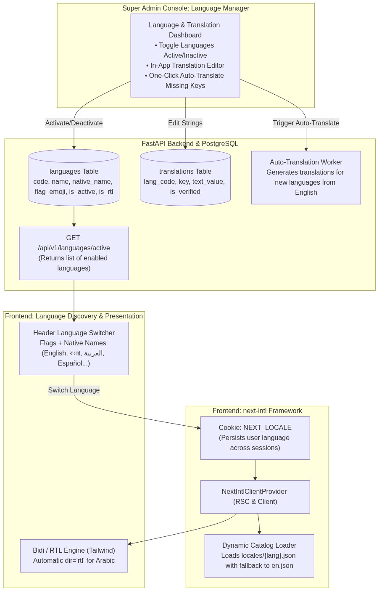
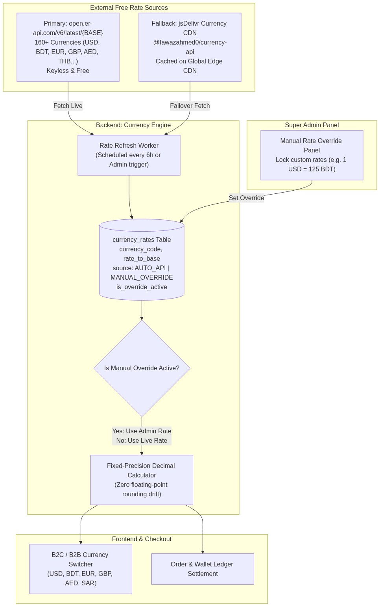
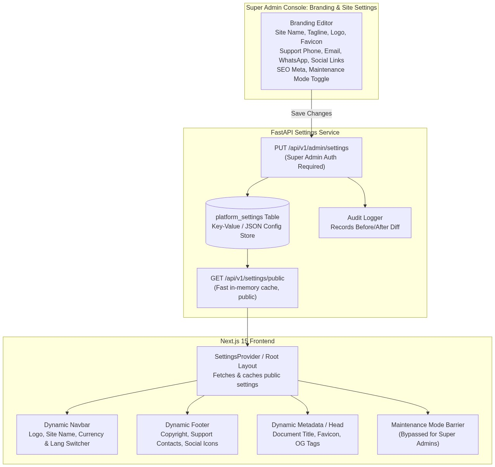
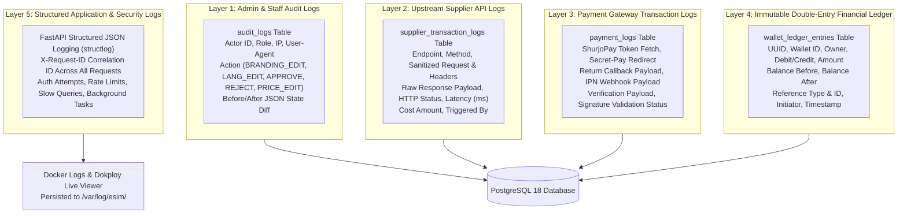
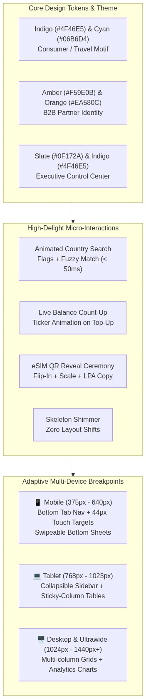
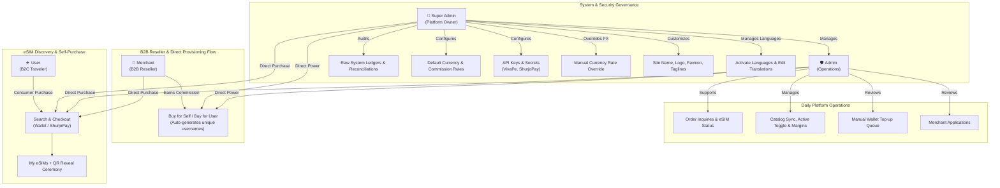
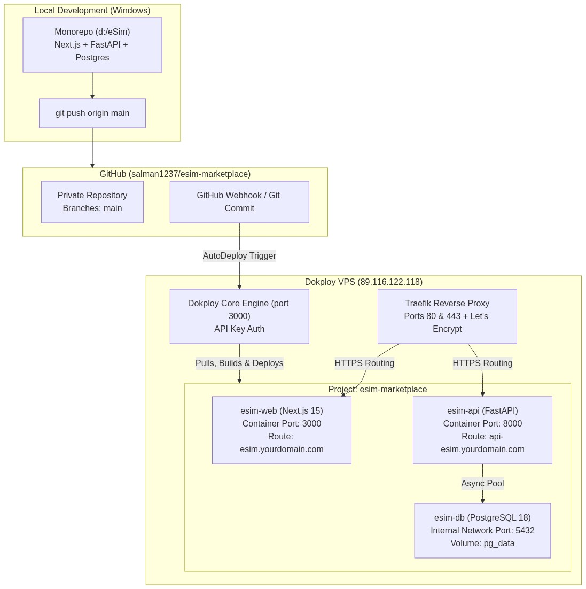
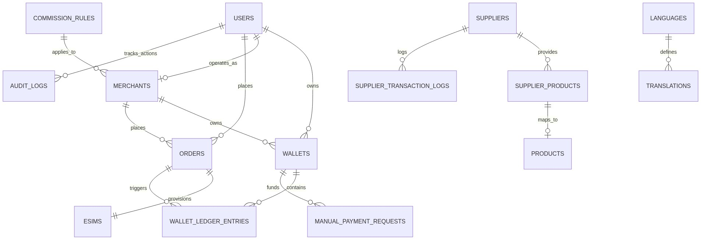
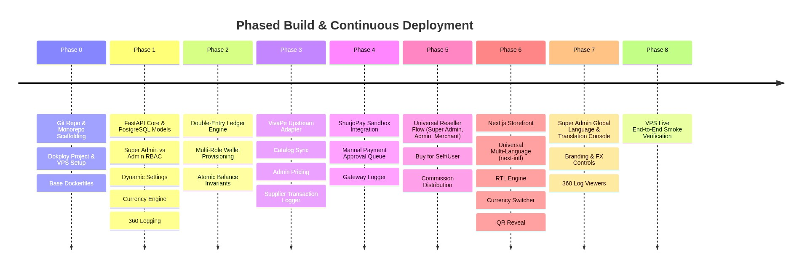
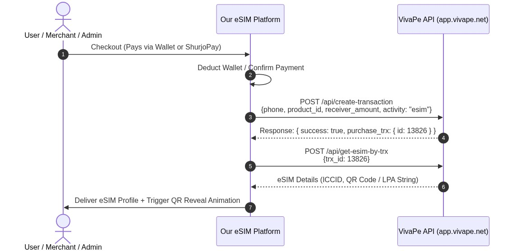

# Implementation Plan — eSIM Marketplace Platform (Next.js + FastAPI + PostgreSQL + Dokploy VPS)

A high-performance, three-sided eSIM marketplace platform serving **Super Admin**, **Admin (Operations)**, **Merchants (B2B Partners)**, and **Users (B2C Travelers)**. Built with a modern **Next.js frontend**, **FastAPI backend**, **PostgreSQL database**, upstream **VivaPe eSIM Aggregator API**, **ShurjoPay sandbox gateway**, and automated CI/CD deployment to your **Dokploy VPS (`89.116.122.118`)**.

---

## User Review Required

> [!IMPORTANT]
> **Key Architecture & Design Decisions Incorporated:**
> 1. **Universal Multilingual Engine (`next-intl`) Supporting All Available Languages**:
>    - **Global Language Catalog**: Full support for all global languages (English `en`, বাংলা `bn`, Arabic `ar` with RTL, Spanish `es`, French `fr`, German `de`, Chinese `zh`, Japanese `ja`, Russian `ru`, Hindi `hi`, Turkish `tr`, Portuguese `pt`, Italian `it`, etc.).
>    - **Super Admin Dynamic Language Manager**: Super Admin can activate/deactivate any language, edit translation strings via an in-app Translation Editor, and trigger auto-translation for missing keys directly from the dashboard without code changes.
>    - **Full RTL (Right-to-Left) Support**: Native bidirectional layout switching (`dir="rtl"`) for Arabic and Middle Eastern travelers.
>    - **Zero-Break Fallback**: Missing keys in any language automatically fall back to English (`en`) gracefully.
> 2. **Free Multi-Currency Engine (`open.er-api.com` + jsDelivr Fallback + Super Admin Override)**:
>    - **Primary API**: Free, keyless ExchangeRate-API tier (`https://open.er-api.com/v6/latest/{BASE}`) supporting **160+ fiat currencies** including BDT, USD, EUR, GBP, AED, SAR, THB, SGD, MYR, JPY.
>    - **Redundant Fallback**: `@fawazahmed0/currency-api` hosted on jsDelivr CDN (`https://cdn.jsdelivr.net/npm/@fawazahmed0/currency-api@latest/v1/currencies/{base}.json`) for 100% uptime resilience.
>    - **Super Admin Manual Override**: Super Admin can at any time lock or manually override any currency rate (e.g. setting $1\text{ USD} = 125.00\text{ BDT}$); manual overrides always take precedence over the API rates.
> 3. **Dynamic Branding & Platform Customization Engine (Super Admin Controlled)**:
>    - **Zero Code Changes for Branding**: Super Admin can dynamically update the **Platform Name**, **Logo** (Light & Dark mode), **Favicon**, **Taglines**, **Support Contacts** (Email, Phone, WhatsApp), **Social Links**, **SEO Metadata** (Title, Meta Description, OG Image), and **Maintenance Mode** directly from the Super Admin Console.
>    - Changes are stored in `platform_settings`, exposed via a fast public settings API, and instantly reflected across the Next.js header, footer, favicon, page metadata, and email templates without rebuilding or redeploying.
> 4. **Complete 360° Logging & Audit Trail System ("Log of Everything")**:
>    - **Admin Action Audit Logs (`audit_logs`)**: Every administrative action (branding edits, merchant approvals/rejections, manual payment approvals, price overrides, catalog changes, currency changes, commission edits, admin account creation) is logged with Actor ID, Role, IP, Timestamp, and Before/After JSON diff.
>    - **Supplier Transaction Logs (`supplier_transaction_logs`)**: Every single outbound call to VivaPe (login, country sync, product sync, create-transaction, get-esim-by-trx) logs the raw URL, headers, request payload, response payload, HTTP status code, and latency (ms).
>    - **Payment Gateway Logs (`payment_logs`)**: Every ShurjoPay interaction (token fetch, secret-pay initiate, IPN webhook, verification check, signature validation) is logged with payload snapshots.
>    - **Immutable Double-Entry Financial Ledger (`wallet_ledger_entries`)**: Append-only money movement records tracking balance-before and balance-after on every credit/debit.
>    - **Structured System Logs**: JSON-formatted application logs with `X-Request-ID` correlation IDs, persisted to disk and Docker stdout for Dokploy log streaming.
> 5. **B2B Reseller Flow & Self-Purchase Enabled for Super Admin & Admin**:
>    - **Buy-for-User / Customer**: Both **Super Admin** and **Admin** can execute the reseller flow directly from the admin portal (searching existing users or auto-generating unique user accounts) to issue/provision eSIMs on behalf of any customer.
>    - **eSIM Self-Purchase**: Both **Super Admin** and **Admin** have full access to browse the catalog, purchase eSIMs for themselves (using wallet balance or ShurjoPay gateway), and access their own "My eSIMs" dashboard complete with the QR reveal ceremony and data tracking.
> 6. **Modern Fintech / Travel-Tech UI/UX (Saily & Airalo Caliber)**:
>    - Full visual parity with tier-1 international travel-tech apps (Saily, Airalo).
>    - Tailored portal accents: User portal (Indigo/Cyan), Merchant portal (Amber/Orange), Admin portal (Slate/Indigo).
>    - Rich micro-interactions: country search autocomplete (< 50ms), animated count-up wallet balances, satisfying flip-and-reveal eSIM QR delivery, and skeleton shimmer loaders.
> 7. **100% Responsive for All Devices (Mobile, Tablet, Desktop, Ultra-Wide)**:
>    - **Mobile (375px - 640px)**: Ergonomic one-handed layout with sticky bottom tab bar (`Search`, `My eSIMs`, `Wallet`, `Account`), touch targets $\ge$ 44px, and swipeable checkout sheets.
>    - **Tablet (768px - 1023px)**: Adaptive collapsible sidebars; complex data tables feature **horizontal scroll with a frozen/sticky first column** so tables never compress or break.
>    - **Desktop & Large (1024px+)**: Multi-column catalog grids, interactive analytics charts, and desktop top navigation.
> 8. **Dokploy VPS Deployment Architecture**:
>    - Managed on your VPS (`89.116.122.118`) via Dokploy API (`x-api-key`).
>    - Deployed under Dokploy project `esim-marketplace` with `esim-api` (FastAPI), `esim-web` (Next.js 15), and `esim-db` (PostgreSQL 18).
>    - Connected to your GitHub account (`salman1237`) with auto-deploy on git push phase by phase.
> 9. **Super Admin vs. Admin Multi-Tier RBAC**:
>    - **Super Admin**: System governance, branding & site identity customization, managing Admin staff accounts, viewing/editing API secrets (VivaPe, ShurjoPay), changing platform default currency, and full ledger audits.
>    - **Admin (Operations)**: Day-to-day operations: merchant onboarding reviews, manual wallet top-up approvals, catalog active toggles, retail price markups, and customer support.
> 10. **Upstream Supplier & Gateway**:
>     - **VivaPe API** (`https://app.vivape.net/api`) live integration for catalog sync and two-step eSIM provisioning.
>     - **ShurjoPay Sandbox** (`https://sandbox.shurjopayment.com`, `sp_sandbox`, `pyyk97hu&6u6`, prefix `NOK`) for instant top-ups and checkouts.

---

## Universal Multilingual & Global Localization Engine (`next-intl`)

To match Airalo's global multi-language capabilities while empowering the Super Admin with complete control over language availability, the platform uses **`next-intl`** integrated with a dynamic database-backed localization system:

*Figure 3: Universal Multilingual & Global Localization Engine (`next-intl`)*

### Multilingual Features:
1. **Extensible to All Languages**:
   - Ships with core global languages pre-compiled: **English (`en`)**, **বাংলা (`bn`)**, **العربية (`ar`)**, **Español (`es`)**, **Français (`fr`)**, **Deutsch (`de`)**, **中文 (`zh`)**, **日本語 (`ja`)**, **Русский (`ru`)**, **हिन्दी (`hi`)**, **Türkçe (`tr`)**, **Português (`pt`)**, **Italiano (`it`)**.
   - Super Admin can add any ISO language code (e.g. `ko`, `id`, `vi`, `th`) dynamically through the Admin panel.
2. **Super Admin Translation Editor**:
   - Built-in visual editor in the Super Admin dashboard allows inspecting and updating translation strings per section (`auth`, `storefront`, `checkout`, `wallet`, `admin`) without touching code files.
3. **Automated Machine Translation Hook**:
   - Super Admin can click "Auto-Translate Language" to automatically translate all English base strings into the newly added language using an integrated translation worker.
4. **Full RTL (Right-to-Left) Support**:
   - For Arabic (`ar`) and other RTL languages, the layout automatically applies `dir="rtl"` and swaps navigation, icons, drawers, and form alignments using Tailwind CSS logical utility classes (`start-`, `end-`, `ms-`, `me-`).
5. **Zero-Break Graceful Fallback**:
   - If any translation key is missing or blank in any language, `next-intl` automatically falls back to the English string, preventing broken UI or empty buttons.

---

## Free Multi-Currency Converter & Rate Engine

*Figure 4: Free Multi-Currency Converter & Rate Engine (`open.er-api.com` + jsDelivr Fallback + Super Admin Override)*

---

## Dynamic Platform Customization & Branding Architecture

*Figure 5: Dynamic Platform Customization & Branding Architecture (Super Admin Controlled)*

---

## 360° Comprehensive Logging & Audit Architecture ("Log of Everything")

---

## Modern UI/UX Design System & Multi-Device Responsiveness

*Figure 7: Modern UI/UX Design System & Multi-Device Responsiveness (Mobile, Tablet, Desktop)*

---

## Role-Based Access Control (RBAC) Matrix

### Detailed Permissions Table:

| Feature / Action | Super Admin | Admin (Ops) | Merchant | User |
|---|:---:|:---:|:---:|:---:|
| **Language & Translation Management** (Activate languages, edit strings, auto-translate) | ✅ **Full** | ❌ No Access | ❌ No Access | ❌ No Access |
| **Site Branding & Identity** (Site Name, Logo, Favicon, Taglines, Social Links) | ✅ **Full** | ❌ No Access | ❌ No Access | ❌ No Access |
| **Admin Staff Accounts** (Create, deactivate, assign admin roles) | ✅ **Full** | ❌ No Access | ❌ No Access | ❌ No Access |
| **System Secrets** (VivaPe credentials, ShurjoPay keys) | ✅ **Full** | ❌ No Access | ❌ No Access | ❌ No Access |
| **Global Platform Base Currency & FX Overrides** (Change base currency, lock rates) | ✅ **Full** | ❌ View Only | ❌ View Rates | ❌ View Rates |
| **Commission Policy Config** (Set default flat %, create tiered rules) | ✅ **Full** | ❌ Read Only | ❌ View Own | ❌ No Access |
| **Audit Logs & Master Ledger** (Inspect all raw action logs & financial ledgers) | ✅ **Full** | ❌ Summaries | ❌ View Own | ❌ View Own |
| **Supplier & Payment Logs** (Inspect raw VivaPe and ShurjoPay API payloads) | ✅ **Full** | ✅ **Full** | ❌ No Access | ❌ No Access |
| **Merchant Applications** (Approve / reject partner requests) | ✅ Yes | ✅ **Yes** | ❌ Apply Only | ❌ Apply Only |
| **Manual Payment Queue** (Verify slips, approve/reject wallet credits) | ✅ Yes | ✅ **Yes** | ❌ Submit Only | ❌ Submit Only |
| **Catalog Operations** (Sync VivaPe, toggle Active/Inactive, set margins) | ✅ Yes | ✅ **Yes** | ❌ Browse Catalog | ❌ Browse Catalog |
| **Order & eSIM Support** (Inspect any customer order, view ICCID & QR) | ✅ Yes | ✅ **Yes** | ❌ Own & Beneficiary | ❌ Own Orders |
| **B2B Reseller / Buy-For-User Flow** (Issue for any user, auto-generate user accounts) | ✅ **Full (Admin Power)** | ✅ **Full (Admin Power)** | ✅ **Full (Commission-enabled)** | ❌ No Access |
| **eSIM Self-Purchase** (Browse plans, checkout via wallet/gateway, My eSIMs QR reveal) | ✅ **Full** | ✅ **Full** | ✅ **Full** | ✅ **Full** |
| **KYC Profile Review** (Review submitted user NID numbers and photo documents) | ✅ Yes | ✅ **Yes** | ❌ No Access | ❌ Upload Own |

---

## Dokploy VPS Deployment Architecture

Dokploy (`https://docs.dokploy.com/docs/core`) manages container orchestration, Traefik reverse proxy, SSL generation, and continuous deployment on your VPS (`89.116.122.118`).

*Figure 9: Dokploy VPS Deployment Architecture (89.116.122.118)*

---

### Database Entity-Relationship Schema

*Figure 2: Database Entity-Relationship Schema (ACID Double-Entry Ledgers, Wallets, Catalog, Orders, eSIMs)*

## Phased Implementation Roadmap

*Figure 10: Phased Build & Continuous Deployment Roadmap*

### Phase 0: Repository, Monorepo Scaffolding & Dokploy VPS Setup
- Initialize Git repository locally: `d:\eSim`.
- Create private GitHub repository `salman1237/esim-marketplace` using `gh repo create`.
- Connect git remote and initialize the `main` branch.
- Call Dokploy API on the VPS to create the `esim-marketplace` project, configure auto-deploy with the GitHub repo, and provision the internal network and database volume.
- Create multi-stage `Dockerfile` for backend and frontend, plus `docker-compose.yml`.

### Phase 1: Backend Core, PostgreSQL Schema, Multi-Role Auth, Dynamic Settings & Currency Engine
- Implement FastAPI application with async SQLAlchemy 2.0 and Alembic.
- Define relational schema supporting the 4 distinct roles (`SUPER_ADMIN`, `ADMIN`, `MERCHANT`, `USER`).
- Build `languages` and `translations` tables: supports dynamic language activation and translation overrides.
- Build `platform_settings` table and service for dynamic site branding.
- Implement **Currency Service**:
  - Connects keylessly to `https://open.er-api.com/v6/latest/USD`.
  - Fallback integration with `@fawazahmed0/currency-api` on jsDelivr.
  - Caches rates in `currency_rates` table with 6h TTL.
  - Provides fixed-point decimal conversion functions.
  - Supports Super Admin manual rate overrides.
- Build core logging tables: `audit_logs`, `supplier_transaction_logs`, `payment_logs`, `wallet_ledger_entries`.
- Implement `AuditMiddleware` and `CorrelationIdMiddleware` (`X-Request-ID`).
- Seed initial **Super Admin** account (`superadmin@esim.local`), default platform branding, settings, and base currencies (`USD`, `BDT`, `EUR`, `GBP`).

### Phase 2: Double-Entry Ledger & Multi-Wallet Engine
- Implement atomic `LedgerService`:
  - Strict append-only ledger entries with row-locking (`SELECT FOR UPDATE`).
  - Strict balance derivation: `Wallet.balance == SUM(WalletLedgerEntry.amount)`.
  - Initialize **Default Wallet** + **Reward Wallet** for Users upon registration.
  - Initialize **Default Wallet** + **Commission Wallet** for Merchants upon approval.
  - Initialize **Default Wallet** for Admins/Super Admins to support direct self-purchasing and issuing.
  - Idempotency key tracking on all financial actions to prevent double debits or credits.

### VivaPe Provisioning Sequence Flow

*Figure 11: VivaPe Two-Step Provisioning Sequence (`create-transaction` -> `get-esim-by-trx`)*

### Phase 3: Upstream VivaPe Supplier Adapter & Catalog Management
- Implement `VivaPeSupplierAdapter`:
  - Bearer token caching & automatic re-authentication via `POST /api/login` (`merchantusd@vivape.co` / `merchantusd@36`).
  - Catalog sync service: pulls 249 countries from `/api/countries` and packages from `/api/products`.
  - Filters and classifies eSIM packages (`reference: "esimgo_bundle"` and `"worldmove_esim"`).
  - Provisioning sequence: `create-transaction` $\rightarrow$ `get-esim-by-trx`.
  - **Supplier Transaction Logging**: Logs full URL, method, request payload, response payload, HTTP status, and duration in ms.
- Admin Catalog APIs (sync trigger, active toggle, retail markup).

### Phase 4: Payment Orchestration (ShurjoPay Sandbox & Manual Queue)
- Implement `ShurjoPayService`:
  - Connects to `https://sandbox.shurjopayment.com` (`sp_sandbox` / `pyyk97hu&6u6` / prefix `NOK`).
  - Token acquisition, secret-pay redirect checkout, and verification callback with signature validation.
  - **Payment Transaction Logging**: Logs all gateway payloads and verification steps.
- Implement Manual Payment Approval Queue:
  - User/Merchant submits payment slip + amount + TxID.
  - Admin/Super Admin single-click **Approve** or **Reject** with full audit logging.

### Phase 5: Universal Reseller & Buy-For-User Engine (Super Admin, Admin, Merchant)
- Reseller & Provisioning workflows:
  - **Merchants**: Can choose "Yourself" or "User" (existing search or auto-generated unique username) and receive commission in their Commission Wallet.
  - **Super Admins & Admins**: Can directly trigger "Issue eSIM for User / Customer" from the Admin portal, searching any user or auto-generating a new customer account.
- Dual visibility of provisioned eSIMs on both the creator's dashboard (Admin/Merchant) and the beneficiary User's dashboard.

### Phase 6: Next.js Frontend — Universal Multilingual Storefront, Search & Checkout (All Roles)
- Implement modern travel-tech UI/UX (Saily & Airalo caliber):
  - **Universal `next-intl` Engine**: Supports all global languages with RTL switching for Arabic, language selector with country flags, and graceful fallback to English.
  - Dynamic branding: Navbar logo, site name, favicon, and footer contacts pulled dynamically from the platform settings API.
  - Multi-currency switcher in header with instant live price conversions.
  - Indigo/Cyan theme with card hover glow.
  - Country-first search with auto-complete, flag icons, instant filtering (< 50ms).
  - Mobile bottom navigation bar (`Explore`, `My eSIMs`, `Wallets`, `Profile`) with $\ge 44\text{px}$ touch targets.
  - Checkout flow with animated count-up wallet balances.
  - Rewarding **QR Reveal Ceremony** animation with LPA manual copy and tabbed iOS/Android guides.
  - Self-purchase available to **all authenticated roles** (User, Merchant, Admin, Super Admin).

### Phase 7: Super Admin Global Language Manager, Branding & FX Console, Admin Operations & 360 Log Viewers
- **Super Admin Portal**:
  - **Language & Translation Manager**: Activate/deactivate any global language, edit translation strings per module, and trigger machine auto-translation for new languages.
  - **Branding & Site Identity Editor**: Upload logo & favicon, edit site name, update taglines, manage support contact numbers/emails, update social links, and toggle maintenance mode with live preview.
  - **Currency Rate Manager**: View live fetched rates from `open.er-api.com`, trigger manual rate sync, and toggle manual rate overrides.
  - Staff management: Create, view, deactivate, and assign `ADMIN` or `SUPER_ADMIN` roles.
  - Platform settings: Update global default currency, edit commission rules, manage API secrets.
  - **360° Log Viewers**: Interactive audit trail viewer, raw financial ledger inspector, and supplier call analyzer with JSON payload inspect modal.
- **Admin Operations Portal**:
  - Approvals queue: Merchant applications and manual wallet recharge receipts.
  - Catalog editor: Active/Inactive product toggles, sell price markups.
  - Customer support: View orders and provisioned eSIM profiles.

### Phase 8: End-to-End Verification & VPS Production Deployment
- Verify Dokploy auto-deployment pipeline on git push.
- Run complete test suite and execute end-to-end smoke test on VPS:
  - Multi-language verification: Test switching between English, Bangla, Arabic (verify RTL mirroring), Spanish, French -> verify zero layout jumps and complete translation coverage.
  - Language activation test: Activate a new language from the Super Admin panel -> verify it instantly appears in the public language dropdown.
  - Currency conversion test: Change currency to BDT -> verify prices reflect live `open.er-api.com` rate; enable manual override -> verify override takes precedence.
  - Dynamic branding test: Update site name and logo from Super Admin console -> verify instant update on frontend without redeployment.
  - Audit log verification: execute actions and verify audit logs, supplier logs, and payment logs.
  - Admin & Super Admin "Buy for User" flow verification.
  - Admin & Super Admin self-purchase and "My eSIMs" verification.
  - User registration $\rightarrow$ Country search $\rightarrow$ Checkout with ShurjoPay Sandbox $\rightarrow$ QR reveal.
  - Merchant application $\rightarrow$ Admin approval $\rightarrow$ Wallet recharge $\rightarrow$ Buy for user $\rightarrow$ Commission credit.
  - Responsive layout validation across mobile, tablet, and desktop viewports.

---

## Verification Plan

### Automated Tests
1. **Universal Localization (`next-intl`) Tests**:
   - Verify dynamic locale loader correctly loads active languages and falls back gracefully to `en` for missing keys.
   - Verify RTL attribute (`dir="rtl"`) is applied correctly for Arabic (`ar`) and Hebrew/Farsi.
   - Verify Super Admin translation updates take effect immediately in the API and frontend.
2. **Currency Engine Tests**:
   - Verify live rates fetch from `open.er-api.com` and fallback to jsDelivr CDN if mock failure is injected.
   - Verify Super Admin manual overrides take priority over live rates.
   - Verify fixed-point decimal arithmetic avoids floating-point inaccuracies.
3. **Dynamic Branding Tests**:
   - Verify Super Admin updates to site name, logo, favicon, and contact info persist to `platform_settings` and are immediately served by `GET /api/v1/settings/public`.
   - Verify audit log is recorded on every branding update with before/after diff.
4. **Audit & Logging Verification**:
   - Verify every admin approval/rejection generates an `audit_logs` record.
   - Verify every VivaPe API call creates a `supplier_transaction_logs` row.
   - Verify every ShurjoPay callback records a `payment_logs` entry.
5. **Double-Entry Ledger Invariants**:
   - Verify concurrent top-ups and purchases never violate balance invariant: `balance == SUM(ledger_entries)`.
6. **RBAC & Privilege Tests**:
   - Verify Super Admin and Admin can successfully execute "Buy for User" and "Self-Purchase".
   - Verify `ADMIN` cannot access Super Admin endpoints (managing admins, editing secrets, changing site branding, managing languages, changing base currency).
7. **Responsive Viewport Tests**: Verify layout integrity across 375px (mobile), 768px (tablet), 1024px (desktop), and 1440px (ultrawide).

### VPS Live Smoke Verification
1. Push initial commit to `main` and verify Dokploy pulls, builds, and starts containers on `89.116.122.118`.
2. Verify Traefik routes SSL traffic to `esim-web` and `esim-api`.
3. Test dynamic language activation and Arabic RTL layout live on the VPS.
4. Test dynamic branding update and currency rate override in the Super Admin dashboard live on the VPS.
5. Complete live end-to-end purchase on the VPS, inspect mobile UX, and verify logs recorded across all 5 logging layers.
