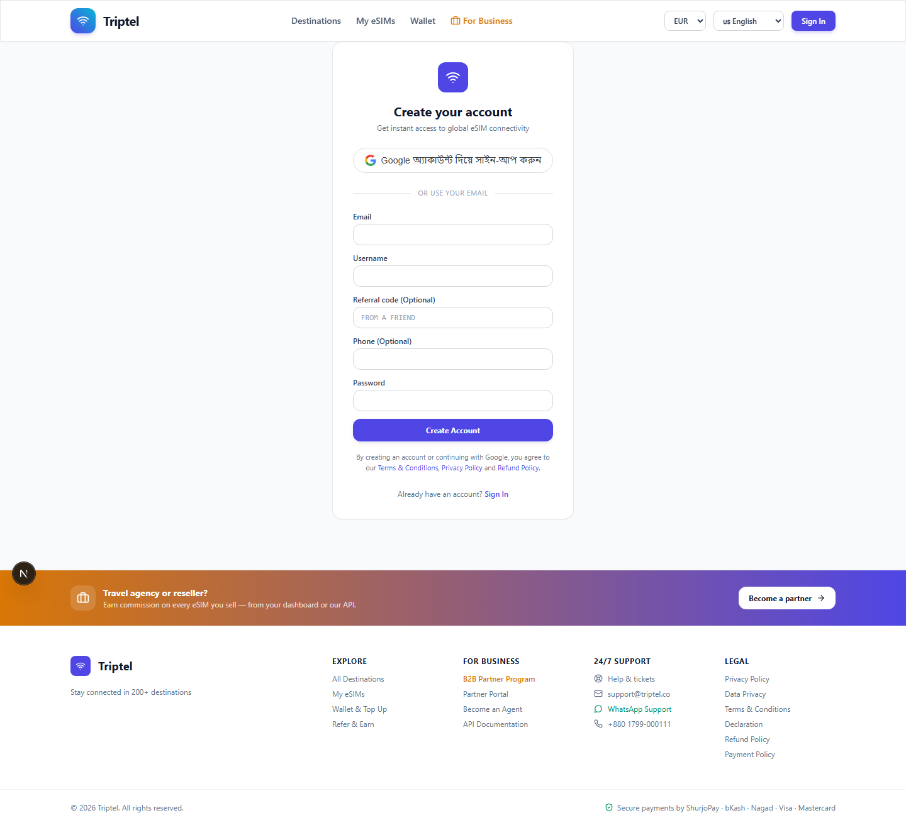
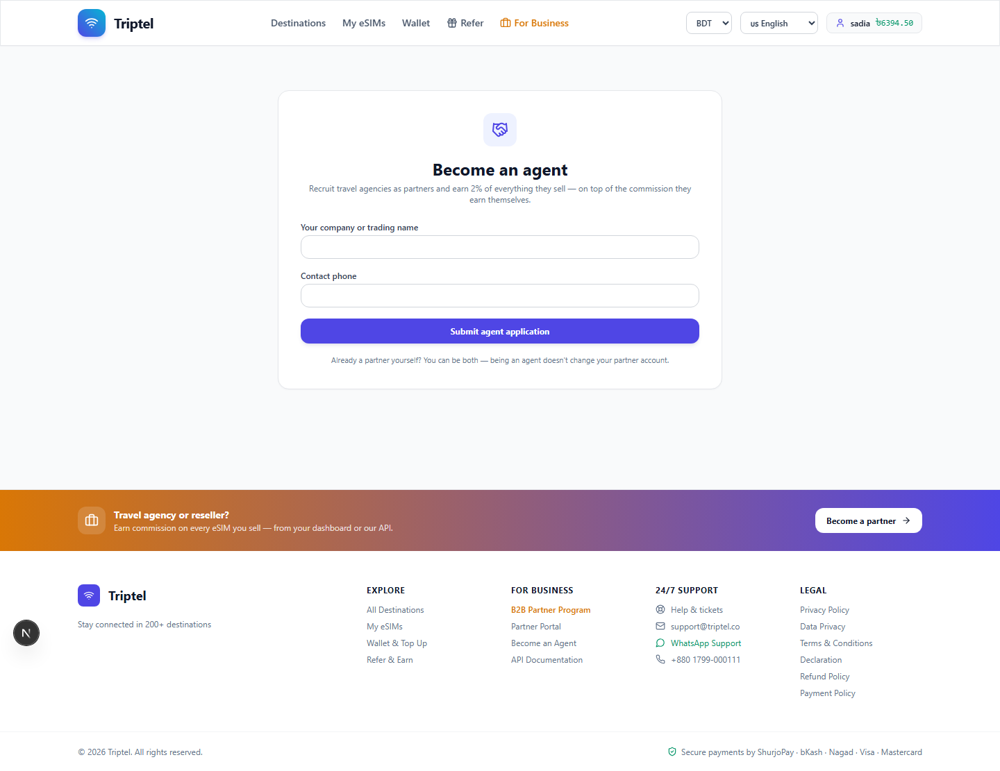
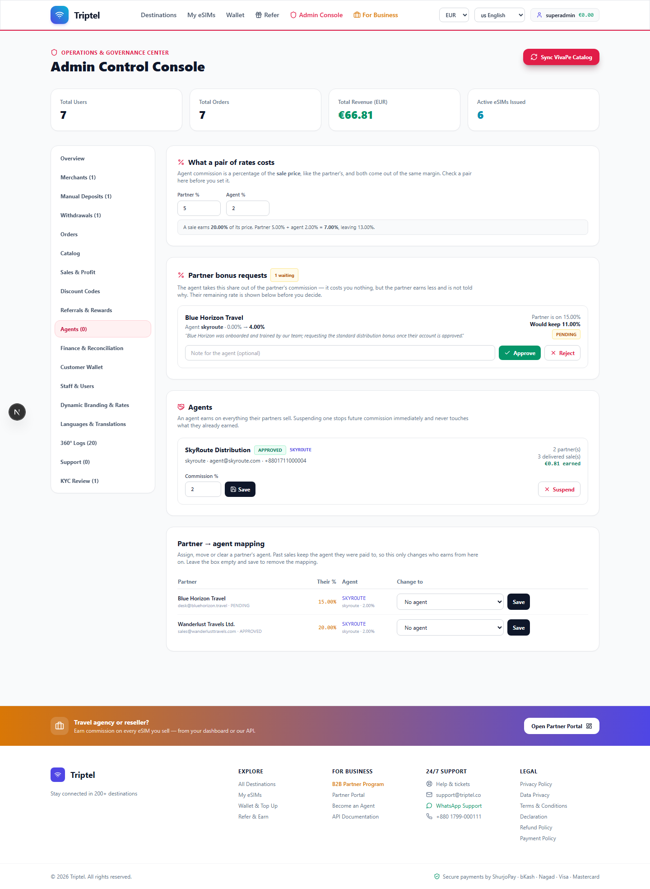
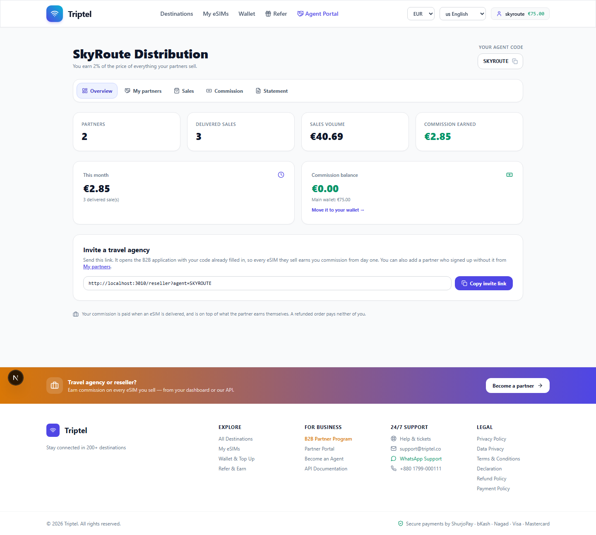
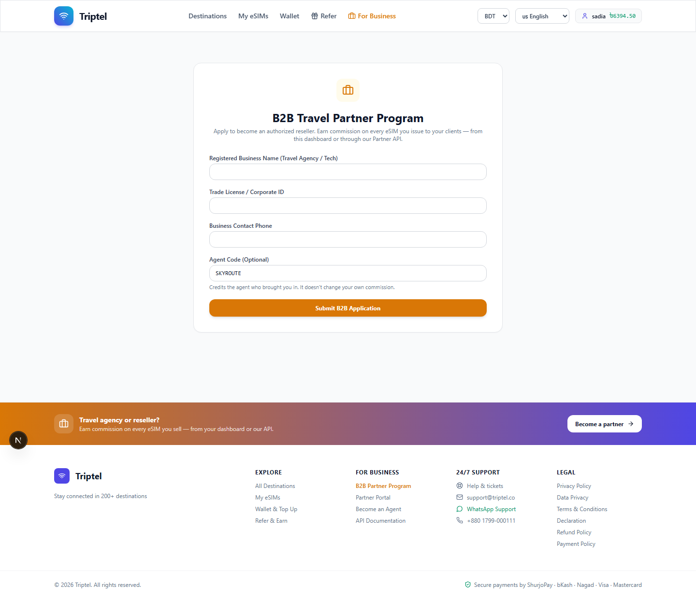
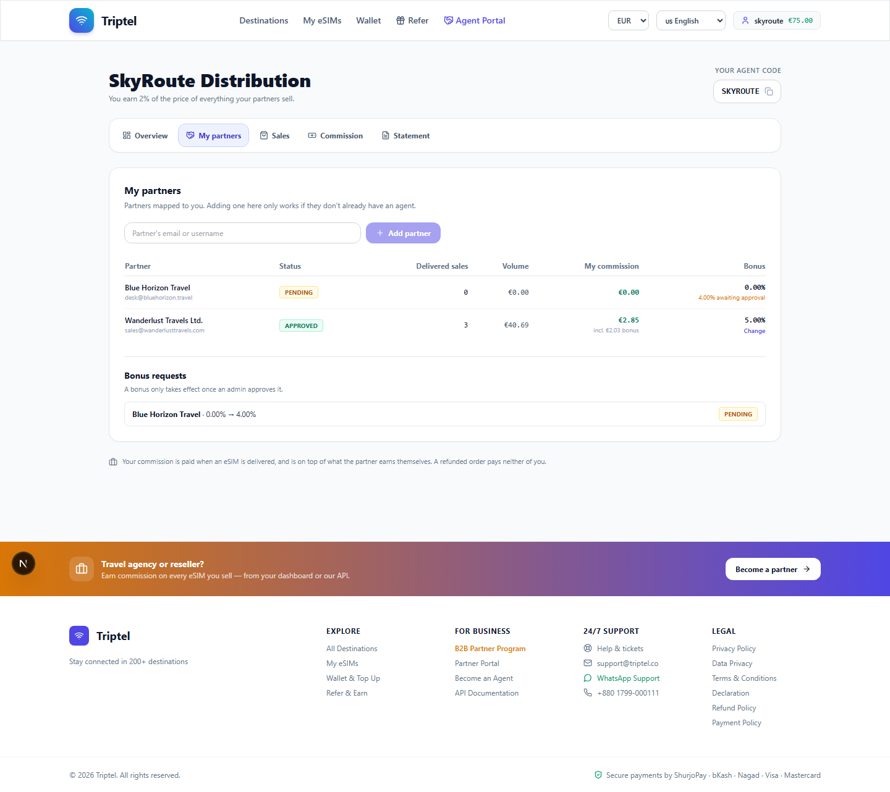
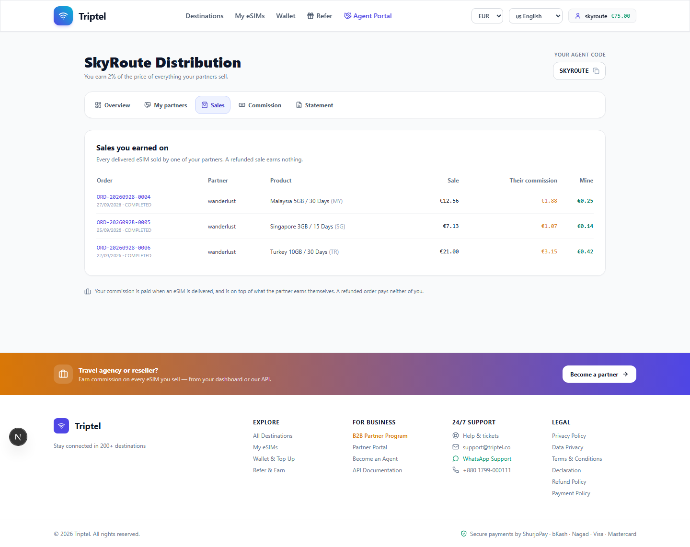
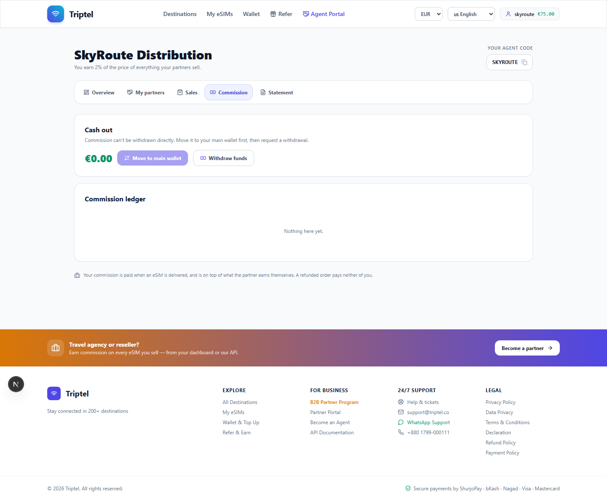
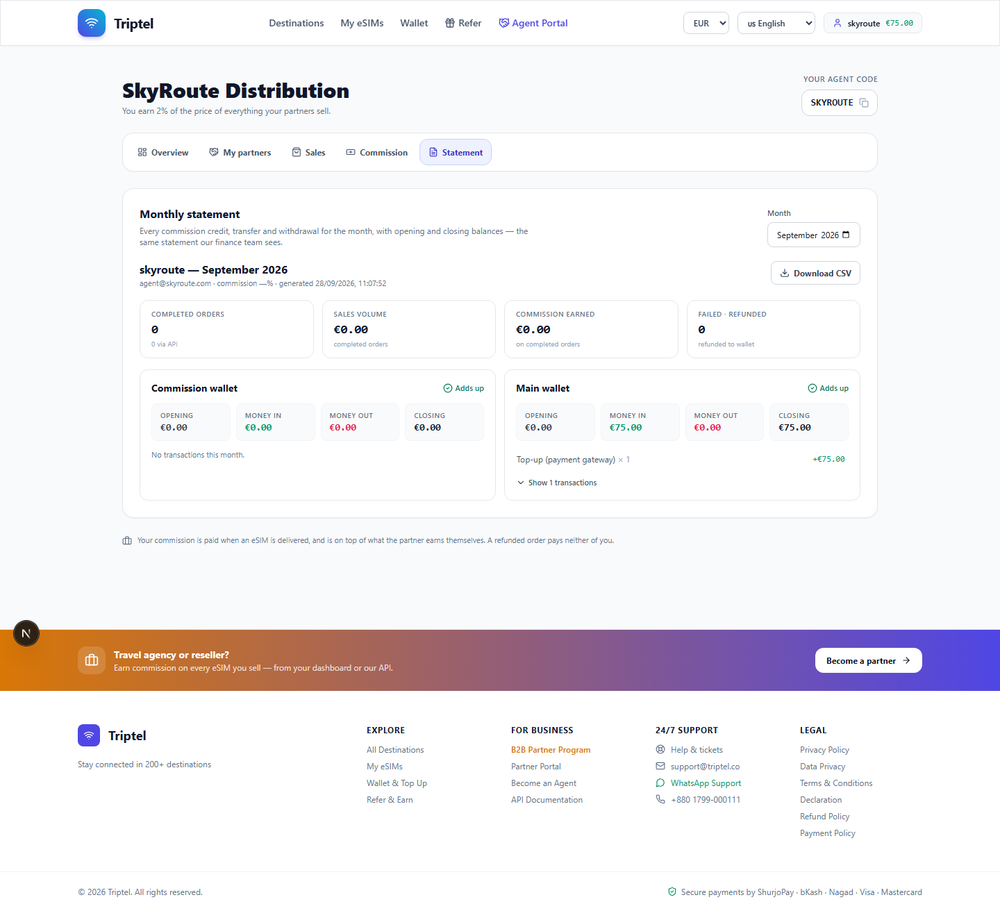

# Agent Registration Process — Triptel

Version 1.0 · 28 September 2026

How a distributor becomes an approved Triptel agent, how they recruit
merchants, and how they earn. Screenshots are from a local demo instance.

---

## 1. What an agent is

An agent is a **distributor**, not a reseller. They do not sell eSIMs to
travellers themselves — they recruit and support travel agencies (merchants),
and earn a percentage of everything those agencies sell.

**What an agent gets**

- A unique **agent code** and a shareable **invite link**
- A percentage of every eSIM their merchants deliver — **2% by default, paid
  on top of what the merchant earns**, not out of it
- The ability to request a **bonus of 0–10%** from an individual merchant's
  commission, subject to admin approval
- A portal showing partners, sales, volume, commission and monthly statements

**What an agent needs**

- A company or trading name
- A contact phone number
- A Triptel account

An agent can also be a merchant. The two are separate profiles on the same
account and neither affects the other.

---

## 2. The process at a glance

```
1. Sign up as a customer              (self-service)
        ↓
2. Submit the agent application       (self-service)
        ↓  emails → applicant, admin, system@
3. Admin reviews and sets the commission rate   (staff)
        ↓
4. Admin approves                     (staff)
        ↓  email → agent, system@
5. Agent Portal appears; agent code and invite link issued
        ↓
6. Agent recruits merchants
        ↓
7. Commission accrues on every delivered sale by those merchants
```

---

## 3. Step by step

### Step 1 — Create an ordinary account

Register as any customer would, with email and password or with Google.



### Step 2 — Apply to become an agent

Reach the form from **Become an Agent** in the site footer, or go to
`/agent` directly.



| Field | Required | Notes |
|---|---|---|
| **Company or trading name** | Yes | Appears as the agent's identity throughout the platform |
| **Contact phone** | Yes | How staff reach them about the application |

The form states the arrangement plainly: *"Recruit travel agencies as partners
and earn 2% of everything they sell — on top of the commission they earn
themselves."* It also notes that being an agent does not change an existing
partner account.

Press **Submit agent application**.

**Emails sent automatically:**

| To | Content |
|---|---|
| The applicant | Confirmation that the application was received |
| Admin | A new agent application is waiting |
| `system@triptel.co` | A copy, for the operational record |

### Step 3 — Staff review

An admin opens **Admin Console → Agents**, where the tab label carries the
pending count.



The reviewer:

1. Checks the company and contact details.
2. **Sets the agent's commission rate** — default 2%.
3. Runs the **margin check** if needed: the console can show whether a given
   agent rate, combined with the merchant rates in play, still leaves the
   platform a margin at the current selling-profit percentage.
4. **Approves**, or **rejects** with a reason.

On approval the system issues a unique, permanent **agent code** (for example
`SKYROUTE`).

**Emails sent automatically:**

| To | Content |
|---|---|
| The agent | Approved, with their agent code and commission rate |
| `system@triptel.co` | A copy |

### Step 4 — The Agent Portal appears



The overview shows partners, delivered sales, sales volume, commission
earned, commission earned this month, the commission balance and a button to
move it into the main wallet — plus the agent code and the invite link.

---

## 4. Recruiting merchants

There are two ways to bring a travel agency in.

### 4.1 The invite link — preferred

Every agent has a link of the form:

```
https://triptel.co/reseller?agent=SKYROUTE
```

Sending it opens the B2B application with the **agent code already filled in**,
so the agency does not have to type it and cannot mistype it. Every eSIM they
sell earns the agent commission from the first sale.



### 4.2 Adding an existing merchant

From **My partners**, an agent can add a merchant by email or username.



This only works if the merchant **does not already have an agent** — an
existing mapping is never silently overwritten. An admin can change a
merchant's agent at any time.

### 4.3 Quoting the code manually

An agency applying on its own can type the agent code into the optional
**Agent Code** field. The effect is identical to using the invite link.

---

## 5. The merchant bonus

Beyond their own 2%, an agent can take an additional **0–10% out of a
particular merchant's commission**. This exists for arrangements an agent
negotiates directly with an agency they onboarded and support.

### How it works

```
Merchant's rate, set by admin           20%
Agent bonus, approved by admin           5%
                                     ───────
Merchant actually receives              15%
Agent receives   own 2%  +  bonus 5%  =  7%
```

### The rules

| Rule | Why |
|---|---|
| Range is **0% to 10%** | The agreed commercial limit |
| **An admin must approve it** before it takes effect | Prevents an agent unilaterally cutting a merchant's rate |
| It is **capped at the merchant's own rate** | A merchant's commission can reach zero but can never go negative |
| The merchant is **never shown it** | Business confidentiality — every merchant-facing figure reports the net rate only |
| A **suspended agent takes no bonus at all** | The deduction is only legitimate if somebody is receiving it; otherwise the merchant gets their full rate back |

### Requesting a bonus

From **My partners**, choose *Change* against a partner and enter the
requested percentage with a reason. The request appears immediately under
**Bonus requests** with a PENDING badge, and the partner row shows the
pending figure — for example *"4.00% awaiting approval"*.


Nothing changes until an admin decides. The admin sees the current
percentage, the requested percentage, the merchant's rate and the resulting
net, then approves or rejects with a note.

---

## 6. Earnings

### What the agent sees







### When commission is paid

Commission is credited to the agent's **commission wallet** at the moment an
eSIM is **delivered**. A refunded order pays neither the agent nor the
merchant — the portal states this explicitly.

### Getting it out

1. **Move commission → main balance** from the Commission tab, or the
   *Move it to your wallet* link on the overview.
2. **Complete KYC.**
3. **Save a payout account** — bank or mobile wallet.
4. **Request a withdrawal.** The amount is held immediately; staff pay it,
   upload proof, and the conversion rate is frozen at approval.

---

## 7. Agent states

| State | Effect |
|---|---|
| **PENDING** | Application submitted; portal locked |
| **APPROVED** | Agent code issued, commission accruing, invite link active |
| **REJECTED** | Declined with a reason, emailed to the applicant |
| **SUSPENDED** | No commission and **no bonus deduction** — merchants mapped to this agent receive their full rate |

---

## 8. Staff checklist

For the admin handling an agent application or bonus request:

**Application**

- [ ] Company name and contact verified
- [ ] Commission rate set deliberately (default 2%)
- [ ] Margin check run against the merchant rates this agent is likely to
      carry
- [ ] Approve, or reject with an actionable reason

**Bonus request**

- [ ] Confirm the merchant is genuinely mapped to this agent
- [ ] Check the requested percentage against the merchant's rate — what will
      the merchant actually be left with?
- [ ] Confirm the combined payout still leaves the platform a margin
- [ ] Approve or reject with a note

Every action is recorded in the audit log with actor, IP and before/after
state.

---

## 9. Frequently asked

**Can an agent sell eSIMs directly?**
Yes, as an ordinary customer or as a merchant if they also hold an approved
merchant profile — but agent commission comes only from their merchants'
sales.

**Does the agent's 2% reduce the merchant's commission?**
No. It is paid on top. Only a separately approved **bonus** reduces the
merchant's rate.

**Can an agent change their own bonus?**
They can request a change. Only an admin can make it effective.

**What if a merchant already has a different agent?**
The mapping is not overwritten. Only an admin can change it.

**Does the merchant find out about the bonus?**
No. Every figure shown to a merchant — dashboard, statement, ledger line,
API response — is the net rate after the bonus. This is a deliberate rule,
enforced in the code that serves merchant-facing data.

**What happens to the bonus if the agent is suspended?**
No deduction is taken. The merchant receives their full rate. The slice is
never taken from one party and paid to nobody.
