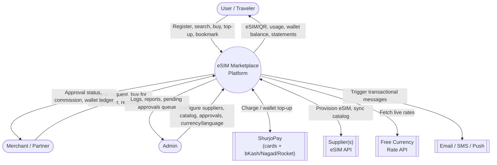

# Build Prompt — eSIM Marketplace Platform (Bangladesh-ready, Global-capable)

> **How to use this file:** This is a self-contained technical build prompt. Hand it to a development team or an AI coding agent (Claude Code, etc.) as the master spec. It merges the original SRS (competitor research on Saily & Airalo, architecture, FR/NFR) with your client's detailed Supplier/Merchant/User requirements, and adds explicit UI/UX design direction. Sections are ordered so a builder can read top-to-bottom and start implementing module by module.

---

## 1. Project Summary

Build a **three-sided eSIM marketplace platform**:

1. **Admin** — configures Suppliers (upstream eSIM sources), manages the product catalog, approves Merchants, approves manual wallet recharges, manages currency/language settings, and monitors all transactions.
2. **Merchant (Partner)** — a B2B reseller who buys eSIMs (for themselves or for their own end-users) using a wallet or ShurjoPay, and earns commission on each sale, similar to Saily's Business dashboard and Airalo Partners, but wallet/commission-driven.
3. **User (Customer)** — a traveler (B2C) who registers, browses/searches eSIM plans by country, pays via wallet or ShurjoPay, and manages their eSIMs post-purchase — matching the core Saily/Airalo consumer experience explored earlier.

The platform does **not** operate its own mobile network — it resells connectivity sourced from one or more **Suppliers** via their APIs (the aggregator layer), exactly as Saily and Airalo do.

---

## 2. Reference Products (context from prior research)

- **Saily** (saily.com, Nord Security): country/regional/Global plans, Ultra subscription, built-in security tools, Business dashboard, referral/credits.
- **Airalo** (airalo.com): 200+ locations, unlimited packages, Loyalty Program, Refer & Earn, Airalo Partners (B2B reseller platform + API), 53-language/multi-currency support.

This platform borrows the **B2C catalog/checkout UX** from both, but replaces their generic "aggregator" and "affiliate" concepts with a concrete **Supplier + wallet-based Merchant commission system**, per the client's requirement below.

---

## 3. Actors & Roles

| Role | Type | Description |
|---|---|---|
| **Super Admin / Admin** | Internal, logs in | Full control: suppliers, catalog, merchants, currencies, languages, approvals, reports |
| **Supplier** | Config entity, *not* a login role in v1 | Represents an upstream eSIM source; Admin manages its API credentials and catalog. (Flag as a future enhancement if suppliers ever need their own login/dashboard.) |
| **Merchant (Partner)** | External, logs in | Reseller with commission + wallets; can buy for self or for a user |
| **User (Customer)** | External, logs in | End traveler; owns wallets, buys/manages eSIMs |
| **Support Agent** | Internal, logs in | Handles tickets/live chat (carried over from prior SRS, optional for v1) |

---

## 4. Design & UI/UX Direction (mandatory)

The platform must feel **modern, trustworthy, and fast** — closer to a fintech/travel-tech product than a plain admin CRUD app. Apply this direction consistently across the User app, Merchant dashboard, and Admin console (each gets its own accent so people always know which zone they're in).

### 4.1 Color Palette

| Token | Hex | Use |
|---|---|---|
| Primary (Indigo) | `#4F46E5` | Primary buttons, links, active nav, User-zone accent |
| Primary Dark | `#3730A3` | Hover/pressed states |
| Secondary (Cyan) | `#06B6D4` | Secondary actions, data/connectivity motifs, chips |
| Merchant Accent (Amber) | `#F59E0B` → `#EA580C` | Merchant dashboard header/accents — visually separates B2B zone from B2C |
| Success (Emerald) | `#10B981` | Active eSIM, approved status, wallet credit |
| Warning (Amber) | `#F59E0B` | Pending approval (manual payment, merchant application) |
| Error (Rose) | `#EF4444` | Failed payment, rejected, expired |
| Neutral ink | `#0F172A` | Body text |
| Neutral muted | `#64748B` | Secondary text |
| Neutral surface | `#F8FAFC` | Light backgrounds |
| Dark surface | `#0B1120` | Dark-mode background |

### 4.2 Gradients
- **Hero / marketing sections:** 135° linear gradient, Indigo `#4F46E5` → Cyan `#06B6D4`.
- **Primary CTA buttons:** horizontal gradient Indigo → Indigo Dark on hover (subtle, not the full hero gradient — keep CTAs readable).
- **Merchant dashboard header:** Amber `#F59E0B` → Orange `#EA580C`, so merchants always feel visually distinct from the consumer app.
- **Card hover glow:** soft box-shadow tinted with the section's accent color (indigo/cyan for User, amber for Merchant) rather than plain gray shadows.
- **Skeleton loaders:** animated gray shimmer gradient while catalog/wallet data loads.

### 4.3 Animation & Micro-interactions
- Page/route transitions: fade + slight slide (Framer Motion if React, or equivalent).
- Buttons: scale to 1.02 + shadow lift on hover, quick scale-down on click.
- **Wallet balance:** animate as a count-up when the page loads or after a top-up/purchase (reinforces "your money, tracked live").
- **eSIM QR reveal:** after successful checkout, reveal the QR code with a scale/flip-in animation — this is the platform's key "reward" moment, make it feel satisfying.
- Toasts/snackbars: slide in from top-right, auto-dismiss, used for payment success/failure, top-up approved, commission earned.
- Country/destination search: animated dropdown with flags, fade+slide as results filter while typing.
- Merchant approval status: an animated stepper (Submitted → Under Review → Approved/Rejected).
- Homepage hero: a light Lottie/SVG illustration with subtle looping motion (both Saily and Airalo use this pattern effectively).

### 4.4 Responsive & Layout
- Mobile-first; breakpoints at 375 / 768 / 1024 / 1440px.
- User app: bottom tab bar on mobile (Home/Search, My eSIMs, Wallet, Account); top nav on desktop.
- Merchant & Admin: collapsible sidebar layout, data-table-heavy screens must remain usable at tablet width (horizontal scroll with sticky first column, not squished tables).
- Touch targets ≥ 44px; all primary flows (search → buy → QR) must work one-handed on mobile.

### 4.5 Typography & Localization
- Latin script: **Inter** or **Plus Jakarta Sans** (clean, modern, good number rendering for currency/wallet figures).
- Bangla script: **Noto Sans Bengali** or **Hind Siliguri**, paired to match the Latin font's weight/x-height so switching languages doesn't visually jar.
- Numerals/currency must render correctly in both language modes; keep digits in Western Arabic numerals unless the client requests Bengali numerals.

### 4.6 Suggested Front-End Toolkit
- Tailwind CSS + a component layer (shadcn/ui works well) for consistent spacing/radius/shadow tokens.
- Framer Motion (or CSS transitions if a lighter stack is preferred) for the animations above.
- Recharts or similar for Admin/Merchant analytics charts, styled with the palette above (not default library colors).
- Support dark mode using the dark surface tokens in 4.1 — optional for v1 but design tokens should be dark-mode-ready from day one.

---

## 5. Recommended Tech Stack

| Layer | Suggestion |
|---|---|
| Web storefront (User) | Next.js/React + Tailwind |
| Merchant & Admin dashboards | Same framework, role-gated routes, or a separate admin app sharing the design system |
| Mobile app | Flutter (matches your existing mobile stack) |
| Backend API | Laravel (matches your freelance stack) or FastAPI — REST, versioned (`/api/v1`) |
| Database | PostgreSQL/MySQL (relational — this system is transaction/ledger-heavy) |
| Cache/Queue | Redis (catalog cache, queued supplier calls, queued notifications) |
| File storage | S3-compatible bucket (manual payment receipt uploads, NID photos, QR images) |
| Payment | ShurjoPay (primary, Bangladesh — cards + bKash/Nagad/Rocket) |
| Currency rates | A free currency-rate API (e.g., exchangerate-api.com free tier), cached and refreshed on a schedule, with Admin override capability |

---

## 6. System Architecture (updated)

1. **Client Layer** — User web/app, Merchant dashboard, Admin console
2. **API Layer** — versioned REST API, role-based auth (JWT/session), separate scopes for User/Merchant/Admin tokens
3. **Core Services**
   - Catalog Service (products synced from Supplier APIs, with Active/Inactive flag and optional admin price override)
   - **Supplier Integration Service** — adapter pattern per supplier (each supplier has its own API URL/credentials/currency), logs every call in the Supplier Transaction Log
   - Order & Checkout Service
   - **eSIM Provisioning Service** — calls the relevant Supplier to issue the eSIM profile/QR
   - **Wallet Service** — manages all wallet types (User Default/Reward, Merchant Default/Commission) as double-entry ledgers
   - **Commission Engine** — calculates and credits Merchant Commission Wallet per sale, per merchant's commission rule
   - **Payment Service** — ShurjoPay integration (direct checkout + wallet recharge) and Manual Payment (receipt upload → pending → Admin approval → ledger credit)
   - **Currency Service** — fetches/caches live rates, supports Admin manual override, and exposes the **admin-configurable default currency** (see §9.5 — no hardcoding)
   - User & Auth Service (User, Merchant, Admin roles)
   - Notification Service (email/SMS/push — order status, approvals, low data, expiry)
   - Support/Ticketing Service
4. **Integration Layer** — ShurjoPay, Supplier APIs (N suppliers), free currency-rate API, email/SMS provider
5. **Data Layer** — relational DB for orders/wallets/ledgers (must be ACID-safe for money movement), object storage for receipts/QRs/NID images, cache for catalog/rates

---

## 7. Context-Level Flow (updated actors)

---

## 8. Core Data Model

| Entity | Key Fields |
|---|---|
| **Supplier** | id, name, api_url, api_username, api_password (encrypted), currency, status (active/inactive) |
| **SupplierProduct** | id, supplier_id, country/region, data_size, validity_days, supplier_cost_price, sync_status |
| **SupplierTransactionLog** | id, supplier_id, request_payload, response_payload, status, cost_amount, created_at |
| **Product** (platform-facing) | id, supplier_product_id, display_name, sell_price, currency, is_active (Active/Inactive toggle) |
| **Merchant** | id, user_id (owner login), business_name, business_info, status (pending/approved/rejected), commission_rule_id |
| **CommissionRule** | id, type (flat % / tiered), value |
| **Wallet** | id, owner_type (user/merchant), owner_id, wallet_type (default/reward/commission), balance, currency |
| **WalletLedgerEntry** | id, wallet_id, type (credit/debit), amount, reference_type (order/topup/commission/manual_payment), reference_id, created_at |
| **ManualPaymentRequest** | id, wallet_id, amount, receipt_file_url, reference_note, status (pending/approved/rejected), reviewed_by_admin_id |
| **User** | id, name, email, phone, username, password_hash, photo_url, nid_number, nid_photo_url |
| **Order** | id, buyer_type (user/merchant), buyer_id, beneficiary_user_id (who the eSIM is actually for), product_id, price, currency, payment_method (wallet/shurjopay), status |
| **eSIM** | id, order_id, iccid, qr_payload, status, activation_date, remaining_data, created_by_merchant_id (nullable) |
| **FavoritePackage** | id, user_id, product_id |
| **CurrencyRate** | id, currency_code, rate_to_base, source (api/manual_override), updated_at |
| **PlatformSetting** | key, value — includes `default_currency` (admin-editable, dynamic) and language toggles |

---

## 9. Functional Requirements

### 9.1 Supplier Management (Admin-only)
- **FR-S1** Admin shall create/edit a Supplier profile with **API URL, API username, API password, and currency**.
- **FR-S2** Admin shall sync/browse the **product/plan catalog per supplier** and map it into the platform's sellable Product list.
- **FR-S3** Every call to a supplier (catalog sync, provisioning, balance check) shall be recorded in the **Supplier Transaction Log** (request, response, cost, status, timestamp) for auditing and cost reconciliation.
- **FR-S4** The Supplier integration shall be pluggable (adapter pattern) so additional suppliers can be added without touching core checkout logic.

### 9.2 Merchant (Partner) Module
- **FR-M1** A user shall be able to **request to become a Merchant/Partner**, submitting basic info + business information; the application status shows as **Pending** in their dashboard.
- **FR-M2** Admin shall **review and approve/reject** merchant applications; on approval the account gains Merchant features.
- **FR-M3** Each Merchant shall have a profile including their **commission rule** and **two wallets**: a **Default Wallet** (for purchasing) and a **Commission Wallet** (where earned commission accrues).
- **FR-M4** Merchant shall be able to **recharge the Default Wallet** via (a) **ShurjoPay** (instant) or (b) **Manual Payment** — upload a receipt image + amount + reference info, which creates a pending request; **Admin approves**, then the wallet is credited.
- **FR-M5** Merchant shall be able to **buy an eSIM** paying either via **ShurjoPay directly** or from **wallet balance**.
- **FR-M6** When buying, the Merchant chooses **"Yourself"** or **"User"**:
  - If **User** → choose **Existing User** (searchable by email, phone, name, or username) or **New User**.
  - If **New User** → Merchant fills in the needed details and the system **auto-generates a username** from the provided name/email (e.g., name-based slug + disambiguating digits if taken; fallback to email local-part + digits), guaranteeing uniqueness.
- **FR-M7** On each completed sale, the system shall calculate and **credit the Merchant's Commission Wallet** per their commission rule.
- **FR-M8** For eSIMs a Merchant creates on behalf of a User, **both the Merchant and that User** shall be able to view the eSIM's details (plan, status, usage).
- **FR-M9** Merchant dashboard shall show sales history, commission earned, both wallet balances, and full transaction history.

### 9.3 User (Customer) Module
- **FR-U1** Registration collects **email, phone, username, password, photo, NID**, and other KYC-lite fields.
- **FR-U2** On registration, the system auto-creates **two wallets**: **Default Wallet** and **Reward Wallet**.
- **FR-U3** eSIM discovery must be **very easy and user-friendly** — primary search by **country**, with fast, forgiving matching (autocomplete, flags, "did you mean") as the main path; secondary filters (region/global/data size) available but not required to find a plan.
- **FR-U4** Users shall be able to **bookmark/favorite** packages for quick repeat purchase.
- **FR-U5** At checkout, Users pay from **wallet balance** or via **ShurjoPay**.
- **FR-U6** Users shall be able to **recharge the Default Wallet** via **ShurjoPay** or **Manual Payment Approval** (same receipt-upload → admin-approval flow as Merchants).
- **FR-U7** After a successful transaction, the eSIM appears in **"My eSIMs"**, where the user tracks **usage (remaining data/validity) and other plan info**.
- **FR-U8** Users shall see a full **transaction and payment statement** (top-ups, purchases, refunds).

### 9.4 Wallet & Payment System (shared by User and Merchant)
- **FR-W1** Every wallet (User Default/Reward, Merchant Default/Commission) is backed by an append-only **ledger** — no balance is ever edited directly; it's always the sum of ledger entries.
- **FR-W2** **Manual Payment flow** (shared component used by both Users and Merchants): submit amount + receipt image + reference note → status `pending` → appears in **Admin's approval queue** → Admin **Approves** (wallet credited, ledger entry written) or **Rejects** (with a reason, no credit).
- **FR-W3** **ShurjoPay flow**: used both for (a) direct one-off checkout payments and (b) wallet top-ups; on gateway callback/webhook, the system verifies and finalizes the transaction (idempotently — see NFR-W1).
- **FR-W4** Reward Wallet balance (Users) shall be usable at checkout alongside/instead of Default Wallet, per whatever reward rules the platform later defines (e.g., referral credits) — structurally ready even if v1 only seeds it via specific promo actions.

### 9.5 Currency & Localization
- **FR-C1** Platform supports **multiple currencies**, rates sourced from a **free currency-rate API**, refreshed on a schedule.
- **FR-C2** **Admin can manually override** any specific currency's rate at any time (manual override always takes precedence over the API-fetched rate until cleared).
- **FR-C3** The **default currency is a platform setting, not hardcoded** — Admin can change it dynamically from the settings panel (ships as USD out of the box, but is fully admin-editable). *(Noted and respected — no hardcoding here!)*
- **FR-C4** Platform supports **Bangla and English** at launch, with an i18n structure that allows adding more languages later without code changes to templates.

### 9.6 Product Catalog
- **FR-P1** Each Product has an **Active/Inactive** toggle; Inactive products are hidden from User/Merchant storefronts but remain visible in Admin for historical order reference.
- **FR-P2** Admin can override the sell price per product independent of the raw supplier cost (to control margin), while the system still tracks supplier cost for margin reporting.

### 9.7 Notifications, Support, Reviews *(carried over from prior SRS, condensed)*
- **FR-N1** Transactional notifications (order confirmed, eSIM ready, top-up approved/rejected, commission earned, low data, expiry) via email/SMS/push.
- **FR-N2** 24/7 support channel (live chat and/or ticketing) for Users and Merchants.
- **FR-N3** User ratings/reviews on plans (optional v1, roadmap-safe).

---

## 10. Key End-to-End Flows

**A. Merchant Onboarding**
1. User submits Partner request (basic + business info) → status `Pending`.
2. Admin reviews → Approve/Reject.
3. On approval, Merchant gains dashboard access, wallets are created, commission rule assigned.

**B. Wallet Recharge (User or Merchant, Manual path)**
1. User/Merchant opens "Recharge Wallet" → enters amount → uploads receipt + reference note.
2. Request enters `pending` state, visible in Admin's approval queue.
3. Admin verifies against the actual payment → Approve (ledger credit, wallet balance updates, notification sent) or Reject (reason sent back).

**C. Merchant Buys an eSIM for a User**
1. Merchant selects a plan → chooses "User" → searches existing user (email/phone/name/username) or creates a new one (system auto-generates username).
2. Merchant pays via wallet or ShurjoPay.
3. System provisions the eSIM via the relevant Supplier, logs the Supplier Transaction, credits Merchant's Commission Wallet per the commission rule.
4. Both the Merchant and the beneficiary User can see the eSIM in their respective dashboards.

**D. User Self-Purchase**
1. User searches by country (primary path) → selects plan → pays via wallet or ShurjoPay.
2. eSIM is provisioned and appears in "My eSIMs" with a QR reveal animation.
3. User tracks usage/validity and sees the transaction in their statement.

---

## 11. Non-Functional Requirements (updated)

### 11.1 Financial Integrity (critical for this system)
- **NFR-F1** All wallet operations must be **atomic and idempotent** — a retried payment webhook or double-submitted manual approval must never double-credit a wallet.
- **NFR-F2** Wallet balances are **derived from ledger entries** (never directly mutated), enabling full auditability and reconciliation against Supplier Transaction Logs and ShurjoPay settlement reports.
- **NFR-F3** Currency conversions must use **fixed-precision decimal arithmetic** (never floating point) to avoid rounding drift in balances/commissions.
- **NFR-F4** Every Admin approval/rejection (manual payment, merchant application) must be **audit-logged** with admin identity and timestamp.

### 11.2 Security & Compliance
- **NFR-S1** Supplier API passwords and ShurjoPay credentials stored **encrypted at rest**, never logged in plaintext.
- **NFR-S2** **NID numbers and NID photos** are sensitive personal data — encrypt at rest, restrict access via RBAC, and apply Bangladesh data-protection-appropriate handling.
- **NFR-S3** ShurjoPay integration relies on ShurjoPay's own PCI-DSS-certified processing — the platform itself should never store raw card data.
- **NFR-S4** Role-based access control across Admin/Merchant/User, with Merchant strictly scoped to their own data (and their beneficiary users' eSIM details only).

### 11.3 Performance & Reliability *(carried over, adjusted)*
- **NFR-P1** Country search returns results in **< 2 seconds**.
- **NFR-P2** eSIM QR delivered within **< 30 seconds** of payment confirmation.
- **NFR-P3** If a Supplier API is down, queue the provisioning request, notify the buyer of the delay rather than failing silently, and retry with backoff.

### 11.4 Usability & Localization *(carried over, adjusted)*
- **NFR-U1** Full UI parity between Bangla and English — no untranslated strings in core flows.
- **NFR-U2** Mobile-first responsive across User, Merchant, and Admin surfaces (see §4.4).

### 11.5 Scalability & Maintainability *(carried over)*
- **NFR-SC1** New Suppliers pluggable without core refactor.
- **NFR-SC2** New currencies/languages addable via configuration, not code changes.

---

## 12. Roadmap

| Phase | Scope |
|---|---|
| **v1 (MVP)** | Supplier config + catalog sync, Product Active/Inactive, User registration + wallets + search + checkout (wallet/ShurjoPay) + My eSIMs, Merchant onboarding + wallets + commission + buy-for-self/user flow, Manual Payment approval queue, Bangla/English, multi-currency with admin override |
| **v2** | Reward Wallet earning rules (referrals), public reseller API for high-volume Merchants, richer analytics/reporting, reviews |
| **v3** | Saily-style value-adds (security suite, phone number add-on), loyalty tiers, travel perks marketplace |

---

## 13. Glossary Additions

| Term | Meaning |
|---|---|
| ShurjoPay | Bangladeshi PSO-licensed payment gateway (shurjoMukhi Limited); supports cards + MFS (bKash, Nagad, Rocket); merchant integration uses a payment URL, username, and password issued after onboarding |
| NID | National ID (Bangladesh) — used here as a KYC field during User registration |
| MFS | Mobile Financial Services (bKash/Nagad/Rocket-style wallets), reachable through ShurjoPay |
| Manual Payment Approval | The receipt-upload → Admin-review → wallet-credit flow used when a user/merchant pays outside ShurjoPay (e.g., bank transfer) |
| Commission Wallet | A Merchant's separate ledger balance accruing earnings from eSIM sales, distinct from their spendable Default Wallet |

---

*This prompt merges the client's Supplier/Merchant/User requirements with the earlier Saily/Airalo-informed SRS. Recommended next step before development: confirm the commission rule model (flat % vs. tiered vs. per-supplier-product) with the client, since it drives both the Wallet Service and Merchant dashboard reporting design.*
